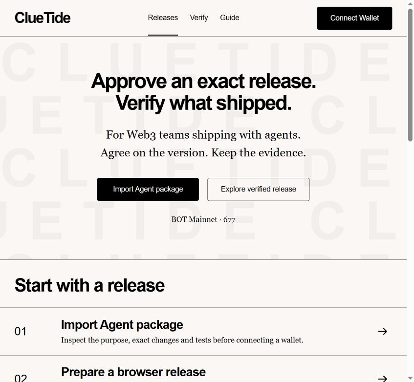
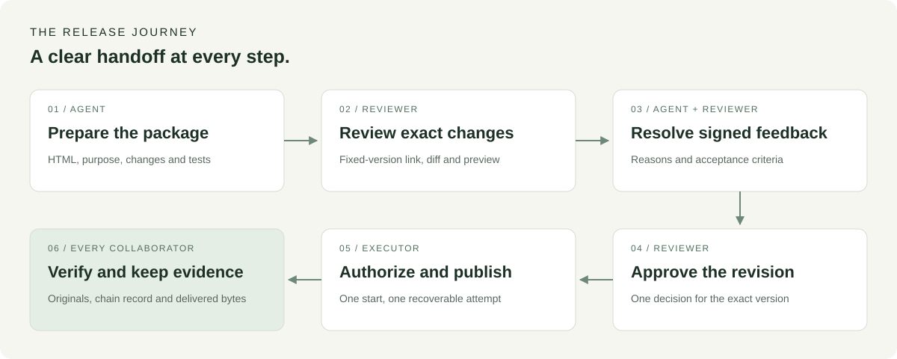
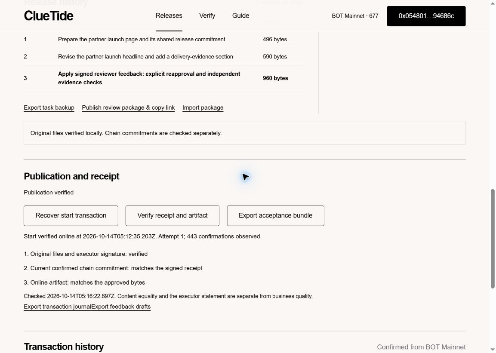
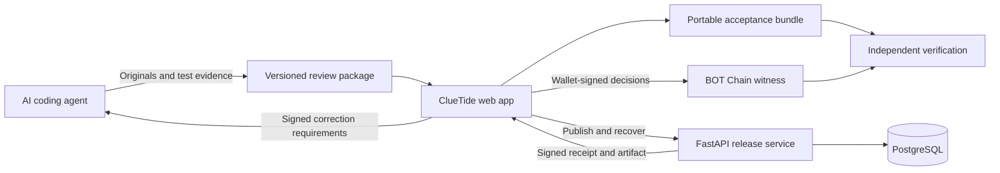

<p align="center">
  
</p>

<p align="center"><strong>AI agent collaboration with accountable releases on BOT Chain.</strong></p>

<p align="center">
  <a href="https://cluetide.vercel.app/">Open the app</a> ·
  <a href="https://cluetide.vercel.app/#/task/0x0fd2d90c3d351480ce7d8de15c62285610d40fa532f31b872777fe0528901b02?version=3">Explore a verified release</a> ·
  <a href="docs/getting-started.md">Run locally</a> ·
  <a href="submission.txt">Chinese submission</a>
</p>

<p align="center">
  <a href="https://github.com/HNNUYUXUAN/cluetide-botchain/actions/workflows/release-validation.yml"></a>
  <a href="https://scan.botchain.ai/address/0xca71b77708674f5f2407c0ad4e599eaf5eb07281"></a>
  <a href="LICENSE"></a>
</p>

## A shared agreement for every release

An AI agent can turn an idea into a launch page in minutes. Shipping it with partners takes a shared agreement: **which version everyone approved, who can publish it, and what actually reached the destination.**

ClueTide gives Web3 teams a complete workspace for that agreement. An agent prepares the work, a designated partner reviews it, and the executor publishes the approved version. Each participant takes away evidence they can verify independently.

**Prepare → Review → Revise → Approve → Publish → Verify.**

[](https://cluetide.vercel.app/)

*Start with an Agent package. Inspect the work, then follow the next action for your role.*

## The story: one launch page, several collaborators

A Web3 project is preparing a partner launch. Its agent builds the page and packages the HTML, release purpose, change summary and test evidence. The project lead imports that package into ClueTide and shares a link to the exact version.

The partner opens the link, reads the changes, examines the preview and decides. Approval commits to that version. A correction carries a reason and acceptance conditions, signed by the reviewer's wallet. The agent reads those requirements and prepares the next revision.

Once the revised page is approved, the executor authorizes one start. ClueTide publishes the approved artifact, checks the downloaded bytes and records the signed receipt. The team now has a shared release history and a portable acceptance package.



## Why teams use ClueTide

| What the team needs | What ClueTide delivers |
| --- | --- |
| Agreement on the actual work | Approval binds to an exact version and its manifest digest. |
| Clear revision requirements | Signed feedback carries the reviewer's reason and acceptance conditions back to the agent. |
| Control over publication | The designated executor consumes a single start authorization for the approved release. |
| Continuity across devices | The original package and start transaction hash restore the same execution attempt. |
| A delivery everyone can inspect | Original files, signed receipts, transaction references and downloaded artifacts travel together. |
| A clear next step | The page shows the required role, wallet address, network, fee estimate and confirmation progress. |

### Why BOT Chain matters

BOT Chain gives collaborators a common, publicly readable record of roles, version commitments, decisions, execution starts and receipts. Each revision returns to review; each approval applies to a specific version; each start consumes its authorization.

That makes changing a release an explicit team decision with a fresh approval trail and observable Gas cost. The approved commitment remains available to every participant, alongside the files and signed evidence used to check delivery.

### Built for agent workflows

ClueTide connects coding agents to human review through a shared package format and a machine-readable CLI. Browser, service and agent exchange the same original materials. Signed feedback becomes actionable input for the next revision, while `wait` exposes the current review and execution state.

| Command | Purpose |
| --- | --- |
| `export` | Produce a review package for a specific task version. |
| `feedback` | Retrieve the reviewer's signed correction requirements. |
| `wait` | Follow approval, correction and execution states. |
| `verify-package` | Validate the package's originals and consistency. |

```sh
python scripts/agent_release.py verify-package --package review-v3.zip

python scripts/agent_release.py --url https://cluetide-release-api.vercel.app \
  feedback --task-id TASK_ID --version-id 2

python scripts/agent_release.py --url https://cluetide-release-api.vercel.app \
  wait --task-id TASK_ID --version-id 3 --interval 5 --timeout 300
```

See the [Agent collaboration guide](docs/collaboration-guide.md) for package export, wallet handoff and public synchronization.

## Try it in a few minutes

### Explore the completed release

1. Open the [verified v3 release](https://cluetide.vercel.app/#/task/0x0fd2d90c3d351480ce7d8de15c62285610d40fa532f31b872777fe0528901b02?version=3).
2. Review its purpose, three versions, changes and assigned roles.
3. Follow the transaction links to BOT Chain and inspect the publication receipt.
4. Download the [acceptance bundle](evidence/complete-mainnet/acceptance-v3.zip), open [Verify](https://cluetide.vercel.app/#/verify), and choose **Verify bundle offline**.

Public review and file verification are available before connecting a wallet.

### Ship your team's release

1. Choose **Import Agent package**, or use **Prepare a browser release** to prepare a task in the app.
2. Review the exact files, changes, tests and role assignments.
3. Connect MetaMask on **BOT Mainnet · 677**. Follow **Your next step** to register and submit the version.
4. Switch to the assigned reviewer to approve it or send signed correction requirements.
5. Import the agent's revision and obtain approval for that version.
6. Use the executor account to **Authorize one start**, publish, verify the result and **Record receipt**.
7. Export the acceptance bundle for your collaborators.

Each transaction displays its fee estimate before wallet confirmation. Prepare BOT for Gas in the accounts that perform on-chain actions. The current release workflow publishes one UTF-8 HTML artifact of up to **32 KiB** to the configured isolated target.

[First-use and recovery guide](docs/first-use-and-recovery.md) · [In-app guide](https://cluetide.vercel.app/#/guide)

## A complete release on BOT Mainnet

The published acceptance task completed **nine business transactions**, a signed review message, three package versions and a verified v3 publication. Its total recorded transaction fee was **0.02004582 BOT**.

| Milestone | Public evidence |
| --- | --- |
| Register the collaboration | [Task registration](https://scan.botchain.ai/tx/0xdd236bacf67d0631daec67af6c92a3e73186bb2707f5e759f685b1f7ad0aead0) |
| Request a correction to v2 | [Correction transaction](https://scan.botchain.ai/tx/0x343d7065dd637a78f4a9c205c2b3df342366454aed2283fc338e16782347618b) |
| Approve the revised v3 | [Exact-version approval](https://scan.botchain.ai/tx/0x52191524ff93cd0a715125bc059c115e313a2e1469d4d9fdb138514bc458628d) |
| Authorize one publication | [Consumed start authorization](https://scan.botchain.ai/tx/0x93638d0448746d42d80aac86a15b2e7509639f9931ec2a2e288d360214ef1a61) |
| Record the delivery receipt | [Final receipt transaction](https://scan.botchain.ai/tx/0x6542bf81beb6225736404396d8dacbf041ecdfc292c0dc1e813f062a2404fd03) |



*The completed release displays three checks: original files and executor signature, confirmed chain commitment, and the actual downloaded artifact.*

[All nine transactions and fees](evidence/complete-mainnet/transactions.json) · [Raw signed receipt](evidence/complete-mainnet/receipt-response-v3.json) · [Acceptance ZIP](evidence/complete-mainnet/acceptance-v3.zip) · [Evidence index](mainnet-evidence.json)

The acceptance run used separate proposer/executor and reviewer addresses operated by one demonstrator. A further [cross-browser publication exercise](evidence/cross-browser-publication/) demonstrates recovery of the original attempt and publication from an independent browser; its per-stage results are recorded in the evidence index.

## Evidence that travels with the work

The acceptance bundle preserves original versions, raw receipt bytes, the downloaded artifact, transaction references and file digests. Collaborators can retain the ZIP, reopen it after a refresh, or verify it on another device.

| Check | What it establishes |
| --- | --- |
| **Originals & signatures** | The package is internally consistent and the receipt is signed by the designated executor identity. Available offline. |
| **Current chain commitment** | A fresh BOT Mainnet read matches the roles, authorization and recorded receipt. |
| **Published artifact** | A fresh download matches the approved artifact bytes. |

Tests and human review assess the page's content and business requirements. Together with the three delivery checks, they give the team a complete acceptance workflow.

## Architecture



| Layer | Technology and responsibility |
| --- | --- |
| Web app | React, TypeScript, Vite and viem; review, wallet handoff, recovery and verification. |
| Agent interface | Python CLI; portable packages and structured review feedback. |
| Release service | FastAPI on Python 3.12; confirmed authorization, execution and signed receipts. |
| Durable state | PostgreSQL on Neon; originals, feedback, attempts and publication results. |
| Chain | Solidity witness on BOT Chain Mainnet; roles, decisions and commitments. |
| Deployment | Vercel frontend and API projects; request-driven service startup. |

## Run locally

Use **Python 3.12** and **Node.js 24**.

```sh
git clone https://github.com/HNNUYUXUAN/cluetide-botchain.git
cd cluetide-botchain
python -m venv .venv
source .venv/bin/activate
python -m pip install -e ".[dev]"

cd frontend
npm ci
npm run build
cd ..

python -m uvicorn cluetide.release_server:app --host 127.0.0.1 --port 8787
```

Open **http://127.0.0.1:8787/**. On Windows, activate with `.venv\Scripts\Activate.ps1`; the repository also provides `scripts/run-local.ps1` for local preview.

For frontend development, run `npm run dev` in `frontend/` alongside the API. Vite serves port **5177** and proxies API requests to **8787**. See [installation and configuration](docs/getting-started.md) for service identities and [Vercel deployment](docs/vercel-deployment.md) for database, signing and environment setup.

## Mainnet configuration

| Setting | Value |
| --- | --- |
| Network | BOT Chain Mainnet |
| Chain ID | `677` |
| RPC | `https://rpc.botchain.ai` |
| Explorer | [scan.botchain.ai](https://scan.botchain.ai) |
| Witness contract | [`0xca71b77708674f5f2407c0ad4e599eaf5eb07281`](https://scan.botchain.ai/address/0xca71b77708674f5f2407c0ad4e599eaf5eb07281) |
| Contract source | [ClueTideReleaseWitness.sol](contracts/ClueTideReleaseWitness.sol) |

## Project map

```text
frontend/           Review, wallet, recovery and verification UI
src/cluetide/       Release API, chain verification and persistence
contracts/          Solidity witness and contract interface
scripts/            Agent CLI, preflight and deployment utilities
tests/              Python, EVM and PostgreSQL integration tests
docs/               Collaboration, setup and recovery guides
evidence/           Mainnet transactions, signed originals and acceptance bundles
provenance/         Deployed source reference and original file manifest
```

The [release validation workflow](.github/workflows/release-validation.yml) exercises the backend with PostgreSQL, startup behavior, frontend tests and production build. [View CI runs](https://github.com/HNNUYUXUAN/cluetide-botchain/actions).

This repository brings together the product source, documentation and public mainnet evidence. The deployed application corresponds to [source revision `1655aa8`](https://github.com/HNNUYUXUAN/cluetide-review/commit/1655aa887fadf30bbdf8a0ce9dfbe02c2b0a1609). File-level provenance is available in the [deployed source manifest](provenance/deployed-source-manifest-1655aa8.json) and [repository manifest](source-manifest.json).

## Contributing

Issues and pull requests are welcome. Include the user workflow, expected result and relevant reproduction steps. For a change to approval, execution or package handling, include tests that exercise the corresponding contract or evidence invariant.

## License

[MIT](LICENSE). Browser dependency notices are available in [BROWSER-DEPENDENCIES.txt](frontend/public/licenses/BROWSER-DEPENDENCIES.txt).
