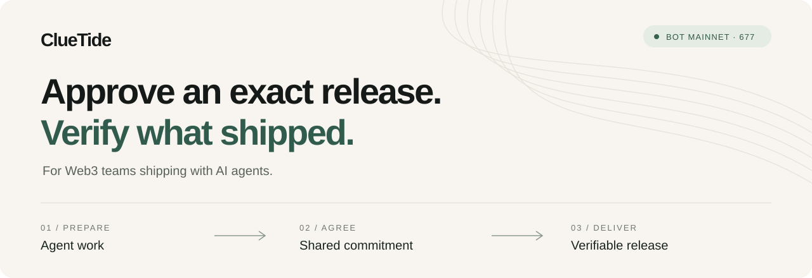

<p align="center"></p>

# ClueTide BOTChain · v0.2.0

**Exact-version release authorization, Safe review and independently verifiable delivery.**

[Historical case](https://cluetide.vercel.app/) · [中文快速入门](docs/quickstart-zh.md) · [Protocol and threat model](docs/protocol-v2.md) · [Releases](https://github.com/HNNUYUXUAN/cluetide-botchain/releases)

## The problem

An agent can prepare an artifact, but a team still needs to establish which bytes were approved, who may publish them, and what reached the destination. ClueTide binds a review decision to a version, manifest, artifact and deadline. A designated executor consumes that authorization once. A durable publisher checks the target before signing its final observation.

The chain proves authorization and the signer's statement. It does not establish business quality or make an external file permanently available. The verifier reports file integrity, EOA signatures, contract-account signatures, chain authorization and current delivery separately.

## A three-version case you can inspect

The [original v3 acceptance ZIP](evidence/complete-mainnet/acceptance-v3.zip) contains the historical BOT Mainnet case, including preceding versions and raw manifests. Its recorded observation is **2026-10-14 05:16:22 UTC**. Open the [fixed-version case](https://cluetide.vercel.app/#/task/0x0fd2d90c3d351480ce7d8de15c62285610d40fa532f31b872777fe0528901b02?version=3) or download the ZIP directly. Neither action requires a wallet.

| Evidence | Protocol | Chain | Contract |
| --- | --- | --- | --- |
| Historical three-version case | Witness v1 | BOT Mainnet 677 | `0xca71b77708674f5f2407c0ad4e599eaf5eb07281` |
| Current local demonstration | Witness v2 / domain 2 | Anvil 31337 | Created locally; shown in the UI and deployment profile |

Historical source, ABI, artifacts and evidence retain their original bytes. [Provenance mapping](docs/provenance-v0.2.0.md) explains the consolidated repository. Current source is maintained at **HNNUYUXUAN/cluetide-botchain**.

## Offline verification

Python 3.12 is required. Install the wheel from the [v0.2.0 release](https://github.com/HNNUYUXUAN/cluetide-botchain/releases/tag/v0.2.0), or install this checkout:

```sh
python -m pip install .
cluetide-release verify evidence/complete-mainnet/acceptance-v3.zip
cluetide-release verify fixtures/v2/eoa-acceptance-v3.zip --deployment fixtures/v2/deployment.json
cluetide-release verify fixtures/v2/safe-acceptance-v3.zip --deployment fixtures/v2/deployment.json
```

The installed command runs without a web server or database. JSON output is stable; exit codes are **0 verified**, **1 invalid**, **2 incomplete**. Networking requires `--online`. An offline Safe signature reports `requires_chain_state`; an unavailable RPC cannot turn that into success.

A deployment profile is a verifier-supplied trust root: chain, contract, runtime hash, receipt signer, confirmations and publication policy. Obtain it separately from the party supplying a ZIP. The included profile describes the local samples; their historical Anvil state is not a public live service.

```sh
# Expected exit code 1: one delivered byte was changed.
cluetide-release verify fixtures/v2/tampered-acceptance.zip --deployment fixtures/v2/deployment.json
```

The compatibility entry remains `python scripts/agent_release.py verify-package --package FILE [--deployment PROFILE]`.

## Local demonstration

From a clean source checkout, run:

```sh
python scripts/demo.py
```

Open **http://127.0.0.1:8787**. The command creates a project environment, installs locked Node dependencies, verifies pinned tool downloads, builds the frontend, starts Anvil, deploys the witness and official Safe contracts, and starts the isolated file publisher. It requires Python 3.12, initial network access and x86-64 Windows or Linux. Docker and a browser wallet are unnecessary.

- State and logs stay under `.local-demo/`; tools stay under `.tools/`.
- RPC and HTTP bind to loopback. Only public Anvil test identities are used.
- Healthy instances are reused. Occupied ports produce an error; unrelated processes are never stopped.
- Choose `--port 8788 --rpc-port 18546 --data .local-demo/second` for another instance.
- `--skip-install` reuses an already prepared environment and frontend build.
- [Recovery guide](docs/recovery-v2.md) explains durable target checks and saved chain state.

Select **Task owner** and create an EOA task. Switch to **Proposer**, submit v1, then use **Reviewer** to request correction and sign feedback. Submit the revised artifact and approve its exact version. Use **Executor** to consume, publish and record the receipt. **Independent verifier** can inspect offline checks, local chain/delivery checks, download evidence and reject a one-byte tamper.

## Safe reviewer demonstration

Create a **Safe task** and use the same workflow. The reviewer is a real **Safe 1.4.1** with three EOA owners and threshold two. **Protocol Kit 8.0.7** builds, signs and executes transactions locally. No Safe Transaction Service is required.

Prepare approval, correction or revocation; sign with two distinct owners; execute. Pending signing data can be exported and imported. Browser and server validate the exact witness target, single zero-value CALL, calldata, nonce and signatures. The server also checks Safe `ExecutionSuccess`, the witness event, canonical block and corresponding state. Outer success with inner failure is rejected.

Feedback uses Safe's official message wrapping and ERC-1271 magic-value validation. Observations record block number, block hash and time. Receipt signing remains EOA-based. Modules, nested contract owners, batches and delegatecall are outside the supported reviewer profile.

[Actual local demonstration](docs/demo-v0.2.0.md) · [Chinese interview guide](docs/interview-zh.md)

## Engineering evidence

```sh
python -m pip install -e ".[dev]" build
python -m pytest tests -q
python scripts/toolchain.py npm ci
python scripts/toolchain.py npm run compile:check
python scripts/toolchain.py node scripts/generate-config.mjs --check
python scripts/toolchain.py forge test -vv
python scripts/toolchain.py forge snapshot --check
python scripts/toolchain.py npm --prefix frontend ci
python scripts/toolchain.py npm --prefix frontend test
python -m build
python scripts/verify-installed.py
```

Browser tests run against the local demo: `python scripts/toolchain.py npm exec playwright install chromium`, then `python scripts/toolchain.py npm run test:e2e`. Real Safe tests require explicit loopback `CLUETIDE_ANVIL_RPC`. PostgreSQL integration tests require `CLUETIDE_TEST_DATABASE_URL`; CI provides an isolated service.

CI rebuilds ABI, creation bytecode and runtime bytecode with **solc-js 0.8.30**, **Paris**, optimizer **200**, and verifies the unchanged v1 artifact. Foundry **1.8.6** runs namespace fuzzing, randomized sequences, single-consumption invariants and Gas snapshots. Python and TypeScript share [protocol vectors](fixtures/v2/shared-vectors.json). Wheel and sdist installation are tested from fresh directories.

[Architecture and threat model](docs/protocol-v2.md) · [Deployment migration](docs/deployment-v2.md) · [Validation record](docs/release-v0.2.0/validation.md) · [Contributing](CONTRIBUTING.md) · [Security](SECURITY.md) · [Changelog](CHANGELOG.md)

## Deployment scope

v0.2.0 delivers local v2 capabilities and a portable verifier. A new real-network v2 deployment, production signer provisioning and production write migration require a separate operational rollout. The historical BOT deployment retains its v1 protocol and evidence. Static updates preserve compatibility with the historical read-only case.

The PostgreSQL publisher remains available for the established v1 production path; the v2 demonstration uses durable file storage. Production v2 database activation is part of the migration checklist.

## License and provenance

ClueTide source is MIT licensed. Safe contracts retain LGPL-3.0; dependencies retain their own licenses. See [third-party notices](THIRD_PARTY_NOTICES.md). Original evidence and provenance manifests retain source bytes and attribution.
