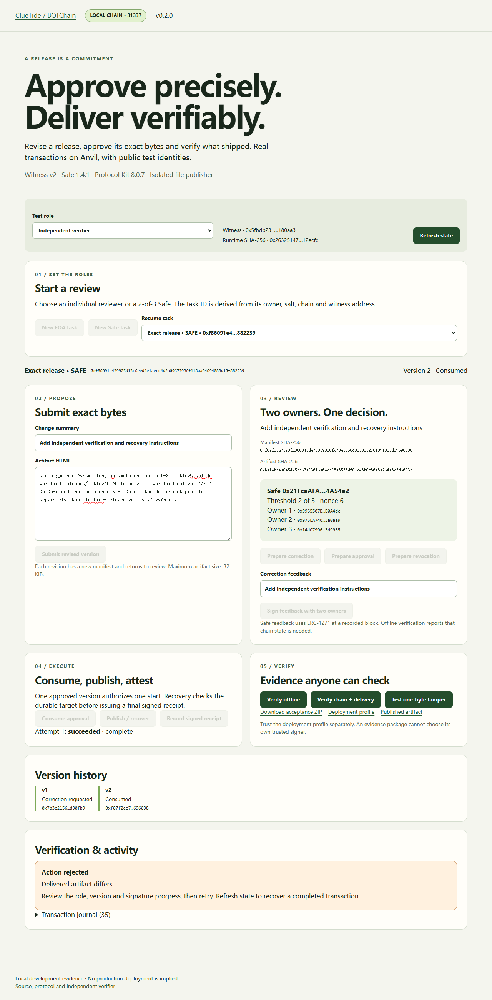

# Actual local demonstration

[Watch the recorded Safe workflow](media/cluetide-v0.2.0-local-demo.webm)

The recording uses the actual browser application, Anvil chain **31337**, public test identities, Witness v2 and official Safe 1.4.1 contracts. It shows a correction, signed feedback, a revised artifact, two-owner approval, authorization consumption, publication, receipt recording, independent checks and a rejected one-byte tamper. Recording metadata is in [recording.json](media/recording.json).

Reproduce with `python scripts/demo.py`, then `python scripts/toolchain.py node scripts/record-demo.mjs`. The recorder drives real UI actions and saves a WebM recording; transaction hashes and timestamps differ between runs. A full three-version headless scenario is also available through `.venv/Scripts/python.exe scripts/demo_scenario.py --rpc http://127.0.0.1:18545` on Windows, or `.venv/bin/python` on Linux.

Suggested walkthrough:

1. Explain the exact-version commitment and local chain label.
2. Create a Safe task and submit v1 as proposer.
3. Request correction with two owners and sign the feedback.
4. Submit a revised version, approve with two distinct signatures and execute.
5. Consume once, publish, and record the EOA receipt.
6. Compare offline checks with explicit chain/delivery verification; show tamper rejection.

The history on BOT Mainnet remains a separate v1 evidence case. This recording does not represent a new production deployment.
