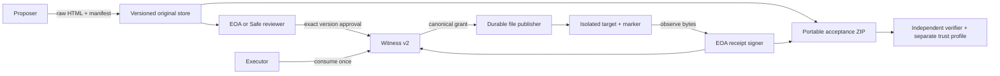
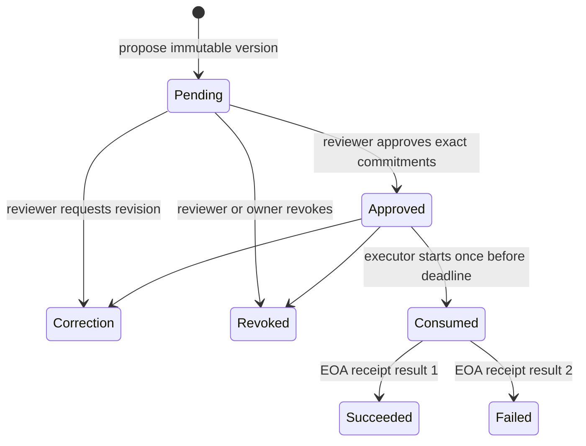

# Protocol v2, architecture and threat model

## Components and trust

The witness authenticates roles, commitments and authorization consumption. A receipt authenticates an executor observation. Neither proves that HTML is useful, that tests are honest, or that a destination will remain unchanged. Artifact bytes are untrusted content; local preview responses use a sandboxed Content Security Policy.

The publisher trusts a separately configured deployment, runtime SHA-256 and EOA receipt signer. A ZIP cannot replace that trust profile. v1 acceptance follows a dedicated compatibility path with the historical BOT contract and signer. Deployment configuration for that path is generated from `configs/historical-bot677.json`. Local v2 browser and server receive the same generated deployment profile from the local controller.

## Task identity and version state

`taskId = keccak256(abi.encode(chainId, witnessAddress, owner, salt))`.

`createTask(expectedTaskId, salt, proposer, reviewer, executor, receiptSigner, targetHash)` verifies the derived identity against `msg.sender`. Another address cannot pre-register the creator’s ID. The namespace changes across owners, chains and witness deployments. A new revision binds a parent version, raw manifest SHA-256, raw artifact SHA-256 and deadline. Review and proposal roles must differ.

Correction and revocation require a new version for another approval. A later revision makes older unconsumed approvals unusable. An already consumed attempt remains valid across subsequent revisions and elapsed deadlines. Competing revoke/consume transactions are ordered by the chain. A completed receipt is immutable: exact replay is idempotent; a conflicting hash or result reverts.

## Signatures and bytes

Receipt EIP-712 domain: `name=ClueTideReleaseWitness`, `version=2`, configured chain ID and witness contract. Fields: taskId, versionId, attemptId, receiptHash, result. Only success and failure are final results. Unknown target state remains `reconciliation_required` off-chain until independently reconciled.

Feedback domain: `name=ClueTideReviewFeedback`, `version=2`, same chain and contract. Fields: taskId, versionId, manifestHash, correctionTransactionHash, contentHash. `contentHash` commits to canonical JSON containing reason and acceptance conditions. The referenced correction transaction is checked against its exact calldata, event and block state when online.

EOA verification requires canonical 65-byte ECDSA signatures, v=27/28 and low-s. Safe feedback signs the typed feedback object through Protocol Kit’s SafeMessage wrapper. ERC-1271 calls `isValidSignature(bytes32,bytes)` and requires the ABI-encoded `0x1626ba7e` magic value. The observation binds a canonical block hash, number and time. Owners may later change: verification at the historical block is a historical result, not a claim about current owners. Offline contract signatures require chain state; RPC interruption yields no independent success.

New manifests and receipts use RFC 8785 canonical JSON. Imported originals retain their raw UTF-8 bytes: byte order marks, whitespace and line endings affect hashes. Duplicate JSON keys, unsafe or duplicate ZIP paths, excessive expansion, unsupported members and conflicting copies are rejected. Limits remain 4 MiB per ZIP and 32 KiB per artifact; the original bounded parser also enforces per-member and member-count limits. Schemas are under `schemas/`; runtime validation additionally enforces cryptographic and cross-document relationships.

## Safe transaction boundary

Supported reviewer operations are approve, requestCorrection and revoke. A proposal binds Safe address, chain, witness, task, exact version, nonce and calldata. Only a single ordinary CALL with zero value is constructed; refund gas price, gas token and refund receiver are zero. Browser and server reconstruct the expected calldata and recover each distinct EOA owner signature. Imported proposals cannot change the context.

After execution, validation checks outer receipt success, exact Safe ABI input, the Safe transaction hash in the indexed `ExecutionSuccess` event, witness decision event and state at the canonical block. An `ExecutionFailure` emitted by a successful outer transaction is rejected. The supported profile has EOA owners and no modules, nested contract owners, delegatecall or batch execution.

Official references: [Safe message signatures](https://docs.safe.global/sdk/protocol-kit/guides/signatures/messages), [Safe v1.4.1 contracts](https://github.com/safe-global/safe-smart-account/tree/v1.4.1), [ERC-1271](https://eips.ethereum.org/EIPS/eip-1271), [EIP-712](https://eips.ethereum.org/EIPS/eip-712).

## Threats and residual limits

| Threat | Enforcement | Residual trust |
| --- | --- | --- |
| Front-running task creation | Owner/chain/contract/salt namespace | Owner must preserve salt and deployment context |
| Substitution or stale approval | Exact version and byte commitments; current-version check | Approval quality remains the reviewer’s responsibility |
| Double publication after crash | Durable attempt, immutable staging, observed target marker | Operator must preserve publisher state and reconcile uncertainty |
| Forged evidence trust root | External deployment profile; known runtime and signer | Profile distribution must be authenticated separately |
| Malicious RPC/reorganization | Chain ID, runtime, confirmations, block-hash rechecks | Single RPC is not a consensus proof; use independent RPCs for high assurance |
| Safe inner failure | Success event hash plus witness event and block state | Owner keys and Safe configuration remain trusted |
| Hostile ZIP/HTML | Bounded parsers and sandboxed artifact response | Do not serve uploaded HTML with privileged application origin |
| Local demo exposed publicly | Loopback bind, host/origin checks, public test identities | Local users control the demo; it is not a production authentication system |

Solidity analysis treats deadline timestamp comparisons as intentional protocol behavior. The analysis gate fails on high-severity findings; other reports are retained for review. An audit and production key-management review remain required before custody-bearing use.
